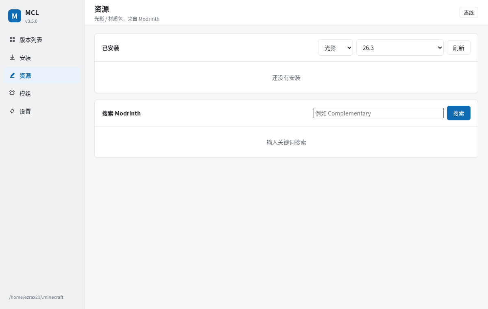

<p align="center">
  
</p>

<h1 align="center">MCL · mclauncher</h1>

<p align="center">Minecraft: Java Edition 启动器：默认图形界面，TUI 作为特色入口。下载原版、装加载器、装模组/整合包、光影材质、启动游戏。</p>

<p align="center">
  <a href="https://github.com/EzraX21/mclauncher/releases"></a>
  <a href="LICENSE"></a>
  
  
</p>

<p align="center">
  <a href="./README_EN.md">English</a> | <strong>简体中文</strong>
</p>

---

## 目录

- [项目状态](#项目状态)
- [功能](#功能)
- [截图](#截图)
- [安装](#安装)
- [运行](#运行)
- [图形界面](#图形界面)
- [TUI](#tui)
- [微软登录](#微软登录暂停)
- [整合包](#整合包)
- [资源](#资源)
- [崩溃分析](#崩溃分析)
- [命令行](#命令行)
- [配置](#配置)
- [下载源](#下载源)
- [CurseForge（可选）](#curseforge可选)
- [命名与发版](#命名与发版)
- [打包](#打包)
- [项目结构](#项目结构)
- [测试](#测试)
- [已知限制](#已知限制)
- [隐私](#隐私)
- [许可证](#许可证)

## 项目状态

当前版本 **v3.8.1**：

| 状态 | 功能 |
| --- | --- |
| ✅ 已完成 | 原版下载、版本管理、Fabric/Quilt/Forge/NeoForge、模组搜索/安装、整合包、光影/材质、崩溃分析、Java 运行时、GUI（默认）、TUI（特色）、多主题、原生窗口、Linux/Windows 打包 |
| 📴 仅离线 | **微软登录**：Mojang 未通过 MCL 的申请，登录已停用；当前只支持离线模式 |
| 🚧 待验证 | **CurseForge 整合包**：下载逻辑已实现，需要 API key；手头没有 key，还没跑真实整合包回归 |
| 🚧 未发布 | **AUR**：`mcl-launcher` 的 PKGBUILD 已就绪，尚未首次提交；CI 的 AUR 步骤在配 secrets 前会失败（已 continue-on-error） |
| 📋 计划中 | 服务器列表 / 快速进服、启动器自动更新、Java 管理 GUI、地图/数据包 |

## 功能

| 模块 | 能做什么 |
| --- | --- |
| 版本 | 列出已装版本（加载器、Java、模组数），启动 / 装加载器 / 打开目录 / 删除 |
| 安装 | Mojang 官方版本清单，边输边筛，可选下载资源文件，进度条 + 日志 + 取消 |
| 模组 | Modrinth / CurseForge 搜索安装，自动补前置；本地模组启用/禁用/删除 |
| 整合包 | Modrinth `.mrpack`、CurseForge zip；自动装原版和加载器，复制 overrides，生成独立实例 |
| 资源 | 光影、材质包搜索安装到 `shaderpacks/` / `resourcepacks/` |
| 崩溃分析 | 解析 crash-report / latest.log，给出 Java 版本、内存、缺前置、Mixin 冲突等建议 |
| 账号 | 离线 + 微软正版（设备代码流），token 本地缓存、自动刷新 |
| Java | 按版本要求选主版本，缺了自动从 Mojang 下载，不会拿新 Java 硬启动老版本 |
| GUI | **默认入口**：原生窗口（Linux WebKitGTK / Windows WebView2），浅色/深色/跟随系统 |
| TUI | **特色入口**：全屏终端界面，适合习惯终端/键盘操作的用户；启动游戏仍需图形环境 |

## 截图

| 浅色 | 深色 |
| --- | --- |
|  |  |

| 安装 | 模组 / 整合包 |
| --- | --- |
|  |  |

| 资源 | 设置 / 微软账号 |
| --- | --- |
|  |  |

## 安装

### 下载 Release

从 [Releases](https://github.com/EzraX21/mclauncher/releases) 下载对应文件：

| 平台 | 文件 |
| --- | --- |
| Windows | `mcl-<ver>-windows-x64-setup.exe`（安装包）或 `mcl-<ver>-windows-x64-portable.zip`（解压即用） |
| Debian / Ubuntu | `mcl-<ver>-linux-x64.deb` |
| Fedora / RHEL | `mcl-<ver>-linux-x64.rpm` |
| Arch | `mcl-<ver>-linux-x64.pkg.tar.zst` |
| Linux 便携 | `mcl-<ver>-linux-x64-portable.tar.gz`（自带依赖，解压后 `./mcl.sh`） |

每个 Release 附 `SHA256SUMS.txt`。包内包名是 `mcl-launcher`，安装后的命令是 `mcl`。

```bash
# Debian / Ubuntu
sudo dpkg -i mcl-<ver>-linux-x64.deb
# Fedora / RHEL
sudo rpm -i mcl-<ver>-linux-x64.rpm
# Arch
sudo pacman -U mcl-<ver>-linux-x64.pkg.tar.zst
```

Windows 安装包会装 `mclw.exe`（双击开原生窗口，无控制台）和 `mcl.exe`（命令行/TUI）。
安装包目前没有代码签名，SmartScreen 提示时点「更多信息 → 仍要运行」。

### 桌面图标

Linux 安装包（deb/rpm/Arch）会自动装上应用菜单项和图标。用 pip/uv 或便携版的话，
第一次运行 `mcl` 会自动补；也可以手动：

```bash
mcl desktop          # 安装菜单项（~/.local/share/applications/mcl.desktop）
mcl desktop remove   # 移除
```

装完 launcher 还搜不到就重新登录一次，或重启 launcher 刷新缓存。

### 从源码

```bash
git clone https://github.com/EzraX21/mclauncher
cd mclauncher
pipx install ".[cli,gui]"     # 或 uv tool install ".[cli,gui]"
mcl
```

`[gui]` 是 pywebview（原生窗口），`[cli]` 是 questionary（`mcl --cli` 文本菜单）。
只跑 TUI 可以只装 `.[cli]`，用 `mcl tui` 进入；默认的 `mcl` 需要 `[gui]`。开发时也可以 `./run.sh` 自动建 `.venv`。

## 运行

```bash
mcl            # 默认：图形界面
mcl tui        # 全屏 TUI（终端管理；启动游戏仍需图形环境）
mcl gui        # 显式打开图形界面
mcl --cli      # questionary 文本菜单
```

## 图形界面

GUI 是默认入口：直接运行 `mcl` 就会打开桌面窗口（`mcl gui` 等价）。
它是**桌面窗口**，不是浏览器标签：

- Linux：GTK + WebKitGTK，需要 `webkit2gtk-4.1`、`python-gobject`
- Windows：WebView2（Win10/11 自带）；安装包里的 `mclw.exe` 直接双击
- Linux 桌面项的 `Exec` 是 `mcl gui`

```bash
# Arch
sudo pacman -S webkit2gtk-4.1 python-gobject
# Debian / Ubuntu
sudo apt install python3-gi gir1.2-webkit2-4.1

mcl gui              # 原生窗口（默认）
mcl gui --web        # 浏览器
mcl gui --electron   # 开发时用仓库里的 Electron
mcl gui --web --no-browser --port 8765   # 只起本地服务
```

界面里能切**浅色 / 深色 / 跟随系统**，设置即时保存。GUI 后端是 `mcl/webui.py`，
只监听 `127.0.0.1`，前端在 `gui/`（TypeScript，esbuild 打包）。

**开发**

```bash
cd gui
npm install --include=dev    # 如果 npm 全局配置了 omit=dev 需要这个参数
npm run build
cd ..
mcl gui --web
```

单独跑 Electron：

```bash
mcl gui --web --no-browser --port 8765 &
MCL_GUI_URL=http://127.0.0.1:8765/ npm --prefix gui start
```

## TUI

TUI 是 MCL 的特色入口，不是默认界面：`mcl tui` 显式进入，适合习惯终端/键盘操作的
用户。它可以在终端里下载版本、装加载器、管理模组；但**启动游戏仍然需要图形环境**。
`mcl` 不会自动退回 TUI，打不开窗口时会明确提示原因。四个标签页：版本、安装、模组、设置。

- `Tab` 切标签，`q` 退出，`ctrl+r` 刷新，`ctrl+s` 保存设置
- 日志默认折叠，开始安装 / 启动时自动展开
- 模组页来源可选 Modrinth / CurseForge，本地模组可启用/禁用/删除

## 微软登录（暂停）

Mojang 审核未通过，当前版本**只支持离线模式**：

- GUI 设置里的「微软登录」按钮已置灰，点击会提示不可用
- `mcl login` 会直接说明登录已停用，不再发起设备代码
- 启动时即使本地有旧账号 token，也会按离线模式处理

登录代码保留在 `mcl/auth.py`，以后重新申请通过再恢复。

## 整合包

支持 Modrinth `.mrpack` 和 CurseForge zip：

```bash
mcl modpack info Fabulously.Optimized.mrpack
mcl modpack install Fabulously.Optimized.mrpack --name "FO 1.20.1"
mcl launch "FO 1.20.1"
```

安装时会：补原版 → 装对应加载器 → 下载模组（sha1 校验）→ 复制 `overrides/` 和
`client-overrides/` → 生成独立实例。GUI 的「模组」页可以直接选文件上传导入。

CurseForge 整合包需要在设置里配 API key（见下）。

## 资源

```bash
mcl resources search shader complementary --version 1.20.1
mcl resources install shader complementary-reimagined --version 1.20.1
mcl resources list shader --version 1.20.1
mcl resources remove shader ComplementaryReimagined_r5.9.3.zip --version 1.20.1
```

支持光影（`shaderpacks/`）和材质包（`resourcepacks/`），GUI 侧边栏「资源」页同样能搜/装/删。

## 崩溃分析

```bash
mcl crash 1.20.1
```

读最新的 `crash-reports/crash-*.txt`（没有就看 `logs/latest.log`），匹配 Java 版本、
OOM、缺前置、模组重复、Mixin 冲突、OpenGL、权限等常见原因并给建议。
GUI 版本列表每行有「崩溃分析」按钮。

## 命令行

```bash
mcl install 1.20.1                  # 装原版
mcl install latest --no-assets -y
mcl versions                        # 已装版本
mcl remove 1.20.1                   # 删除版本（-y 跳过确认）
mcl versions remove 1.20.1          # 同上
mcl loaders fabric 1.20.1           # 装 Fabric
mcl loaders forge 1.20.1            # 装 Forge（官方安装器）
mcl loaders neoforge 1.21.1         # 装 NeoForge
mcl launch 1.20.1                   # 启动
mcl launch 1.20.1 --dry-run         # 只打印命令
mcl launch 1.20.1 --offline         # 强制离线
mcl mods search sodium --version 1.20.1
mcl mods install sodium --version fabric-loader-0.20.1-1.20.1 -y
mcl modpack install pack.mrpack --name "我的整合包"
mcl resources search shader complementary --version 1.20.1
mcl crash 1.20.1                    # 分析崩溃
mcl java install 21                 # 下 Java 运行时
mcl account                         # 查看离线状态
mcl desktop                         # 安装 Linux 桌面菜单项
mcl config                          # 查看配置
mcl doctor --network                # 环境自检
```

完整参数看 `mcl <命令> --help`。

## 配置

路径：

- Linux：`$XDG_CONFIG_HOME/mcl`（默认 `~/.config/mcl`）
- Windows：`%APPDATA%\mcl`
- macOS：`~/Library/Application Support/mcl`

配置文件 `config.json`，可以用 `mcl config set <key> <value>` 修改：

| 配置 | 说明 |
| --- | --- |
| `game_dir` | 游戏目录，默认 `~/.minecraft` |
| `java_path` | 指定 Java；留空按版本自动找 |
| `memory_mb` | 内存 MB，默认 4096 |
| `username` | 离线用户名 |
| `isolate_versions` | 版本隔离，默认开 |
| `jobs` | 下载并发，默认 8 |
| `download_source` | `official`（默认）/ `auto`（BMCLAPI 优先）/ `custom`（自定义镜像） |
| `mirror_url` | 自定义镜像 base URL（根路径提供 version_manifest_v2.json；兼容 BMCLAPI 回退） |
| `theme` | GUI 主题：`light` / `dark` / `system` |
| `ms_client_id` | 覆盖内置 Azure client id（可选） |
| `curseforge_api_key` | CurseForge API key（可选） |

环境变量：`MCL_CONFIG`（覆盖配置路径）、`CURSEFORGE_API_KEY`（优先于配置文件）。

## 下载源

默认 `official`：只连 Mojang 官方 CDN。国内慢可以切 `auto`：BMCLAPI 优先，失败回退官方：

```bash
mcl install 1.20.1 --source auto
mcl config set download_source auto
```

覆盖：版本清单 / JSON / client jar / 库 / 资源对象 / Java 运行时 / Fabric meta，
Modrinth API 与 CDN 走 `mod.mcimirror.top`。Quilt 没有镜像，始终官方。

### 自定义镜像

如果有一个在根路径提供 `/version_manifest_v2.json` 的镜像，可以填 base URL（也兼容 BMCLAPI 的 `/mc/game/...` 回退）：

```bash
mcl config set download_source custom
mcl config set mirror_url https://mirror.example.com

# 或者只对这一次生效
mcl install 1.20.1 --mirror https://mirror.example.com
```

自定义镜像只改写 Mojang 的版本清单 / JSON / jar / 库 / 资源 / Java / Fabric meta；
Modrinth 仍走官方（或 `auto` 的 mcimirror）。镜像失败会自动回退官方源。
GUI 和 TUI 的设置里也能选「自定义镜像」并填 URL。

## CurseForge（可选）

默认用 Modrinth。CurseForge 需要自己申请 API key（审核制），本项目不内置、不代申请。

1. 注册/登录 CurseForge（Overwolf）账号
2. 填官方申请表：<https://support.curseforge.com/support/solutions/articles/9000208346-about-the-curseforge-api-and-how-to-apply-for-a-key>
3. 通过后 key 发到邮箱

```bash
export CURSEFORGE_API_KEY=你的key
mcl config set curseforge_api_key 你的key
```

也可以 TUI → 设置 → CurseForge key 粘贴。配置后 `mcl doctor` 会显示已配置。
部分作者禁用了第三方下载，这类文件拿不到直链，会明确报错。

## 命名与发版

| 层 | 名称 |
| --- | --- |
| 产品 / 全名 | MCL / mclauncher |
| 命令 | `mcl` / `mcl-tui` |
| Python 包 / 发行包 | `mcl` / `mcl-launcher` |
| 配置目录 | `~/.config/mcl` |

- 版本：`v3.8.0`、`v3.8.0-beta.1`、`v3.8.0-rc.1`（代码用 PEP 440：`3.8.0b1`）
- 产物：`mcl-<ver>-<platform>-<arch>[-variant].<ext>`，deb/rpm/Arch 文件名也统一；
  wheel 保持 PEP 427
- 每个 Release 附 `SHA256SUMS.txt`
- beta/rc 发成 GitHub Pre-release，AUR 跳过

```bash
python3 packaging/release.py          # 交互问版本号
python3 packaging/release.py --version 3.8.0 --commit
```

## 打包

```bash
./packaging/build_linux.sh             # deb / rpm / Arch / wheel / 源码 / 便携 tar.gz
powershell -File packaging/build_windows.ps1   # setup.exe + portable.zip
```

CI（`.github/workflows/release.yml`）在推 `v*` tag 时构建 Linux + Windows 并汇总 Release。
AUR 配置好 secrets 后会自动更新；首次提交仍需要手动在 AUR 网页创建 `mcl-launcher`。

## 项目结构

```
mclauncher/
├── mcl/                  Python 包
│   ├── cli.py            子命令；无参数打开 GUI，失败退回 TUI
│   ├── tui/              Textual TUI
│   ├── gui_cmd.py        GUI 启动（pywebview / Electron / 浏览器）
│   ├── webui.py          GUI 的本地 HTTP + JSON 服务
│   ├── auth.py           微软设备代码登录
│   ├── modpacks.py       整合包导入
│   ├── resources.py      光影 / 材质包
│   ├── crash.py          崩溃日志分析
│   ├── versions.py       inheritsFrom 合并 / 版本扫描
│   ├── launch.py         启动参数 / classpath / natives
│   ├── installer.py      下载计划与落地
│   ├── net.py            并发下载 / 校验 / 续传
│   ├── java.py           Java 探测与 Mojang 运行时
│   ├── modrinth.py       Modrinth API
│   ├── curseforge.py     CurseForge API
│   └── ...
├── gui/                  TypeScript 前端（esbuild）
├── docs/                 README 截图
├── tests/                109 个测试
├── packaging/            deb/rpm/Arch、Windows、macOS、AUR、发版脚本
└── pyproject.toml
```

## 测试

```bash
python -m unittest discover -s tests -v
```

109 个测试，覆盖规则、下载计划、版本合并、启动参数、Java、模组、整合包、资源、
删除、TUI（无需终端）和 GUI API；不需要网络。

## 已知限制

- 微软登录被 Mojang 拒绝，当前只支持离线模式
- CurseForge 整合包需要 key，且尚未做真实包回归
- Windows 安装包未签名，SmartScreen 会提示
- macOS 只有手动构建脚本，Release 不发布 dmg；GUI 在 macOS 上会退回浏览器
- AUR 还没首次提交
- 资源目前只有光影/材质，地图、数据包还没做
- 服务器列表、自动更新、Java 管理 GUI 还没做

## 隐私

不收集任何数据、没有遥测。登录在微软页面完成，密码不经过 MCL；token 只存本机
（0600）。详见 [PRIVACY.md](PRIVACY.md)。

## 许可证

GNU General Public License v3.0 **或更新版本**（GPL-3.0-or-later），完整文本见 [LICENSE](LICENSE)。
Copyright (C) 2026 mcl contributors.
