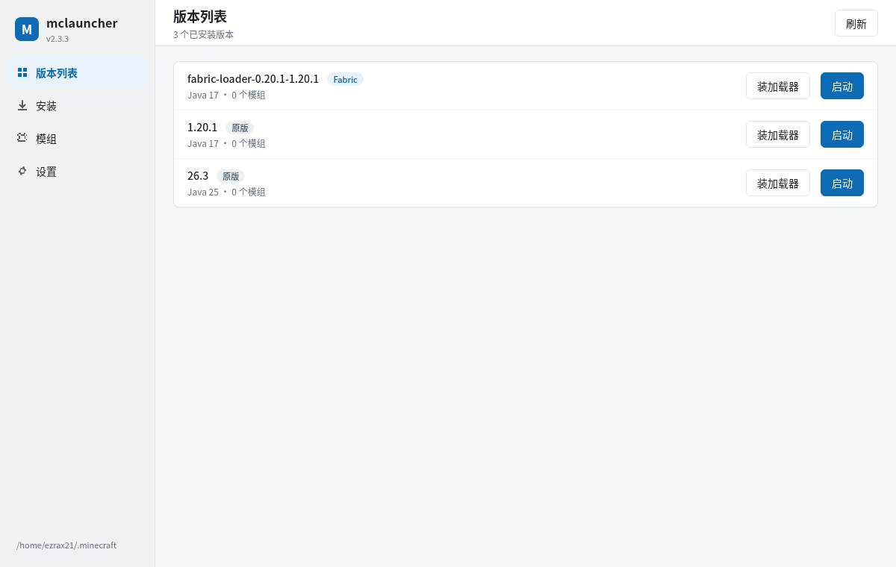
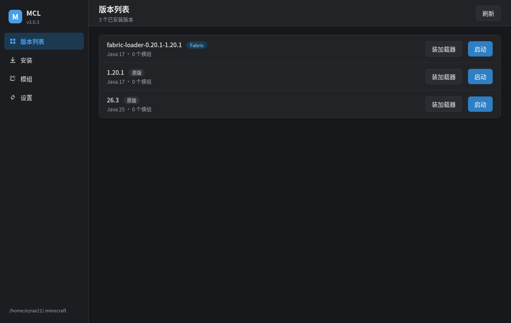
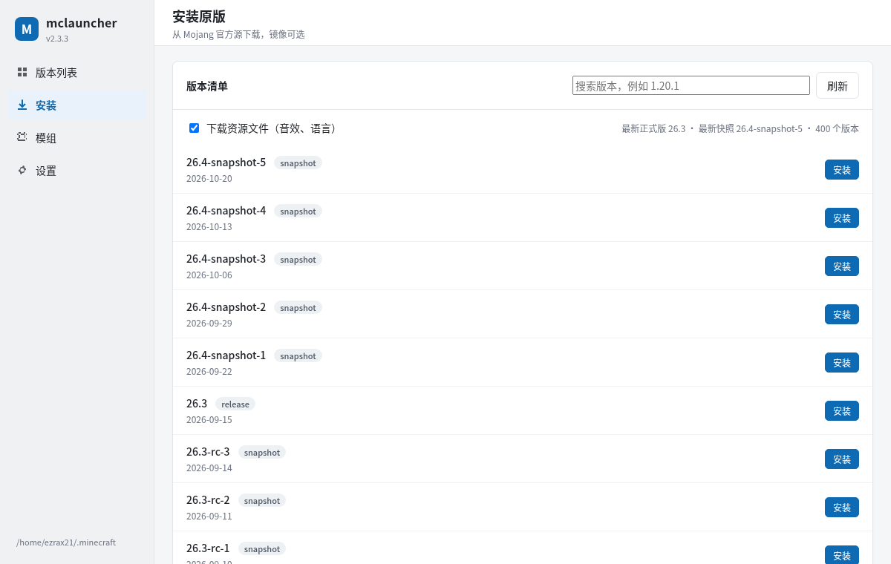
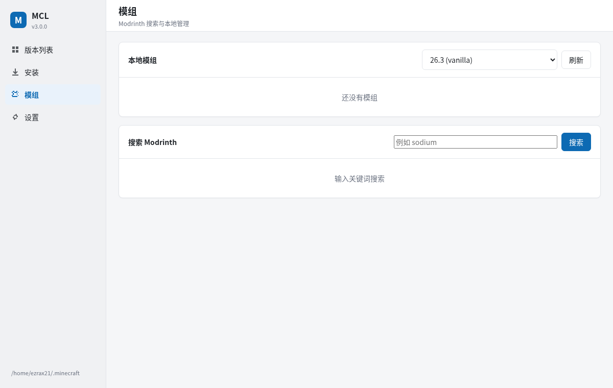
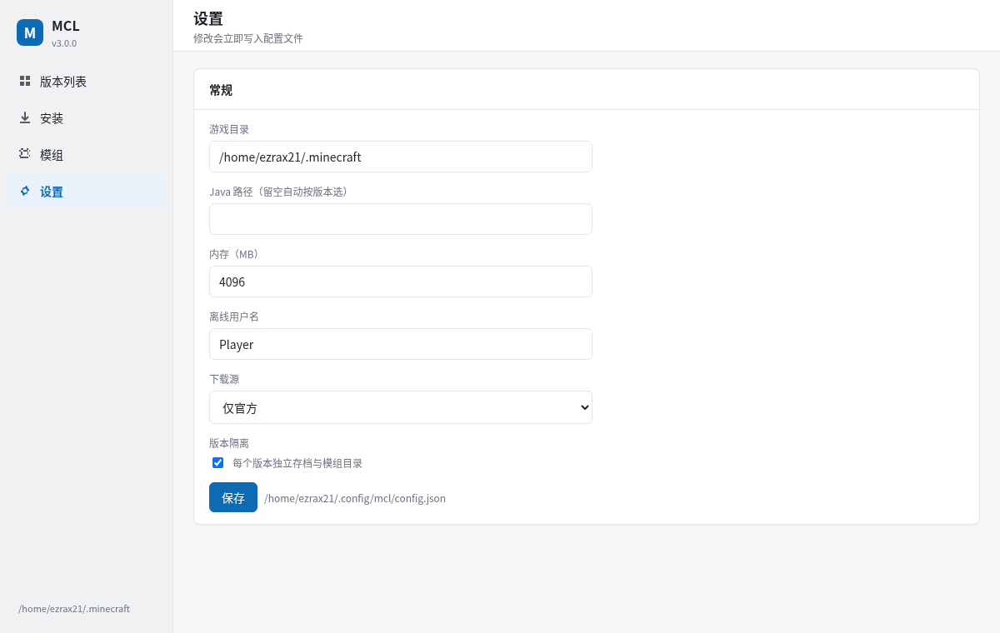

# MCL（mclauncher）

> 全名 **mclauncher**，命令和包名是 `mcl`。Minecraft 启动器：全屏 TUI + 图形界面，下载原版、装 Fabric/Quilt/Forge/NeoForge、搜模组、启动游戏。
> 默认走 **官方源**；想要镜像可以切 BMCLAPI（和 PCL 同一套）。

PCL 2.99 起不再提供游戏本体下载。这个项目把「下载 → 装加载器 → 装模组 → 启动」这条链路自己做了一遍，
文件来源和 PCL 一致（BMCLAPI 优先、官方兜底），启动参数按官方 launcher 的规则构建。

## 界面

```
┌ mcl ───────────────────────────── v3.5.0 · Minecraft 启动器 ─┐
│ 版本 │ 安装 │ 模组 │ 设置                                              │
├──────────────────────────────────────────────────────────────────────┤
│ 版本                    加载器      Java    模组   客户端             │
│ 1.20.1                  vanilla     17      0      ✓                  │
│ fabric-loader-0.20.1-1.20.1  fabric 17      3      —                  │
│                                                                      │
│ [刷新] [启动] [装加载器] [日志] [打开目录] [删除]                     │
│ ── 日志 ──────────────────────────────────────────────────────────    │
└──────────────────────────────────────────────────────────────────────┘
  q 退出   ctrl+r 刷新   ctrl+s 保存设置
```

- **版本**：表格列出已装版本（加载器、Java、模组数），按钮启动 / 装加载器（Fabric、Quilt、Forge、NeoForge）/ 打开目录 / 删除
- **安装**：加载官方版本清单，边输入边筛选，勾选是否下资源，进度条 + 日志，随时可以「取消安装」
- **模组**：选版本后看本地模组，启用/禁用/删除；来源可选 Modrinth 或 CurseForge，搜到后直接装（自动补前置，也能取消）
- **设置**：游戏目录、Java、内存、用户名、版本隔离、下载源

按键：`Tab` 切标签，`q` 退出，`ctrl+r` 刷新，`ctrl+s` 保存设置。日志默认折叠，点「日志」按钮展开；开始安装 / 启动时会自动展开。

## 图形界面

除了 TUI，还有一套 Electron + TypeScript 的图形界面，配色和布局参考 PCL：
左侧图标导航、顶部标题栏、白底卡片、蓝色主色。



```bash
mcl gui           # 原生桌面窗口（pywebview：GTK/WebView2/WKWebView）
mcl gui --web     # 浏览器
mcl gui --electron  # 开发时用仓库里的 Electron
mcl gui --no-browser --port 8765   # 只起服务
```

窗口是真正的桌面窗口，不是浏览器标签页。Linux 依赖 WebKitGTK 和 PyGObject：

```bash
# Arch
sudo pacman -S webkit2gtk-4.1 python-gobject
# Debian / Ubuntu
sudo apt install python3-gi gir1.2-webkit2-4.1
pip install "mcl-launcher[gui]"
```

deb / rpm / Arch 包已经把 `python3-gi`、`webkit2gtk-4.1` 写成依赖，装包时自动带上。
没有 pywebview 时会退回 Electron（仓库里）或浏览器。

TUI 里能干的事 GUI 里都有：版本列表（启动 / 装加载器）、安装原版（进度条）、
Modrinth 搜索与本地模组管理、设置。设置里可以切**浅色 / 深色 / 跟随系统**。



| 安装 | 模组 |
| --- | --- |
|  |  |



**开发**

```bash
cd gui
npm install --include=dev   # 如果 npm 全局配置了 omit=dev 需要这个参数
npm run build               # 产出 gui/dist
cd ..
python -m mcl gui --web
```

单独跑 Electron 窗口：

```bash
python -m mcl gui --web --no-browser --port 8765 &
MCL_GUI_URL=http://127.0.0.1:8765/ npm --prefix gui start
```

GUI 的后端是 `mcl/webui.py`，只监听 `127.0.0.1`，提供 `/api/state`、
`/api/install`、`/api/mods`、`/api/launch` 这些接口；前端产物会打进 wheel / deb / rpm。

## 微软登录（可选）

默认离线启动；想要正版皮肤、进正版服务器，可以登微软账号。

**注册 Azure 应用（免费，5 分钟）**

1. 打开 https://portal.azure.com → **Microsoft Entra ID** → **应用注册** → **新注册**
2. 名称随便填（例如 `MCL`）；账户类型选 **仅个人 Microsoft 账户**；重定向 URI **留空**
3. 进应用 → **身份验证** → **允许公共客户端流** → **是** → 保存
4. 回到 **概述**，复制 **应用程序(客户端) ID**
5. 不需要创建 client secret，也不用配 API 权限

**配置并登录**

```bash
mcl config set ms_client_id 你的-client-id
mcl login        # 按提示打开 microsoft.com/devicelogin 输入代码
mcl account      # 查看当前账号
mcl logout       # 退出
```

GUI 里在「设置 → 微软账号」填 client id 点登录，窗口会显示设备代码。
登录成功后会缓存到 `~/.config/mcl/accounts.json`，启动时自动刷新，过期就退回离线。
`mcl launch --offline` 可以强制离线。

## 安装

### pipx（推荐，隔离环境 + 自带命令）

```bash
pipx install "mcl-launcher[cli]"
mcl
```

`[cli]` 是可选依赖（questionary），只有退回文本菜单 `mcl --cli` 时才需要；
只装 TUI 的话 `pipx install mcl-launcher` 就够。

### uv

```bash
uv tool install "mcl-launcher[cli]"
```

### pip

```bash
pip install --user "mcl-launcher[cli]"
```

Windows 上用 `py -m pip install --user "mcl-launcher[cli]"`，然后在 **Windows Terminal** 里运行 `mcl`。
安装包会同时装 `mclw.exe`（双击即开原生窗口，无控制台）和 `mcl.exe`（命令行/TUI），开始菜单里两个入口都有。

### Arch Linux（本机 PKGBUILD）

```bash
# 在项目根目录
tar czf ../mcl-2.0.0.tar.gz --exclude=.venv --exclude=.git .
cd .. && makepkg -si -p mcl/packaging/PKGBUILD
```

装完自带 `/usr/share/applications/mcl.desktop`。

### 从源码跑（开发）

```bash
git clone <repo> && cd mclauncher
./run.sh          # 自动建 .venv 并安装依赖
```

## 系统集成

- 配置：Linux `$XDG_CONFIG_HOME/mcl`，macOS `~/Library/Application Support/mcl`，Windows `%APPDATA%\mcl`
- 缓存：`$XDG_CACHE_HOME/mcl` / `~/Library/Caches/mcl` / `%LOCALAPPDATA%\mcl\cache`
- 自检：`mcl doctor`（`--network` 顺便测下载源）
- 卸载：`pipx uninstall mcl-launcher` / `pacman -R mcl-launcher`，配置目录自己删
- 版本：`mcl --version`

### 配置项

配置文件在 `~/.config/mcl/config.json`（macOS/Windows 见上），也可以用命令改：

```bash
mcl config                    # 查看
mcl config set memory_mb 8192
mcl config set download_source auto
mcl config set curseforge_api_key 你的key
```

| 配置 | 环境变量 | 说明 |
| --- | --- | --- |
| `game_dir` | — | 游戏目录，默认 `~/.minecraft` |
| `java_path` | — | 指定 Java，留空自动找 |
| `memory_mb` | — | 内存 MB，默认 4096 |
| `username` | — | 离线用户名 |
| `isolate_versions` | — | 版本隔离，默认开 |
| `jobs` | — | 下载并发，默认 8 |
| `download_source` | — | `official`（默认）/ `auto`（BMCLAPI 优先） |
| `curseforge_api_key` | `CURSEFORGE_API_KEY` | 可选，用 CurseForge 模组源时需要，**由用户自己申请** |

配置里的 key 是明文存的，介意的话 `chmod 600 ~/.config/mcl/config.json`，或者只用环境变量。

## 整合包

支持 Modrinth 的 `.mrpack`：自动装对应原版 + 加载器（Fabric/Quilt/Forge/NeoForge）、
下载模组、复制 `overrides`，生成一个独立实例。

```bash
mcl modpack info Fabulously.Optimized.mrpack
mcl modpack install Fabulously.Optimized.mrpack --name "FO 1.20.1"
mcl launch "FO 1.20.1"
```

CurseForge 的整合包也能导，但需要先在设置里填 CurseForge API key。
GUI 的「模组」页可以直接选文件导入，不用敲命令。

## 崩溃分析

启动失败或闪退时，读 `crash-reports/` 里最新的报告（没有就看 `logs/latest.log`），
匹配 Java 版本、内存、缺前置、模组重复、Mixin 冲突、OpenGL、权限这些常见原因：

```bash
mcl crash 1.20.1
```

GUI 里在「版本列表」每个版本后面点「崩溃分析」，会弹窗列出原因和建议，日志末尾可展开。

## 命令行模式

TUI 之外保留了完整子命令，脚本和 CI 里能用：

```bash
mcl install 1.20.1                  # 装原版
mcl install latest --no-assets -y
mcl loaders fabric 1.20.1           # 装 Fabric
mcl loaders forge 1.20.1            # 装 Forge（跑官方安装器）
mcl loaders neoforge 1.21.1         # 装 NeoForge
mcl mods search sodium --version 1.20.1
mcl mods install iris --version fabric-loader-0.20.1-1.20.1 -y
mcl launch 1.20.1                   # 启动
mcl launch 1.20.1 --dry-run         # 只打印命令
mcl java install 21                 # 从 Mojang 下 Java 运行时
mcl versions                        # 版本列表
mcl doctor --network
```

`mcl --cli` 会回到原来的 questionary 文本菜单（需要 `[cli]` 依赖）。

## 下载源

默认 `official`：只连 Mojang 官方 CDN，最正统但国内可能慢。
想走镜像就切 `auto`——BMCLAPI 优先，失败自动回退官方（规则和 PCL 一致）：

| 类型 | 镜像写法 |
| --- | --- |
| 版本清单 / 版本 JSON / client jar | `bmclapi2.bangbang93.com` + 原路径 |
| 库 | `bmclapi2.bangbang93.com/maven/<group>/<artifact>/...`（`/libraries` 备选） |
| 资源对象 | `bmclapi2.bangbang93.com/assets/<前两位>/<hash>` |
| Java 运行时 | `bmclapi2.bangbang93.com/v1/products/java-runtime/...` |
| Fabric meta | `bmclapi2.bangbang93.com/fabric-meta/v2/...` |
| Modrinth API / CDN | `mod.mcimirror.top/modrinth`、`mod.mcimirror.top` |

Quilt 没有镜像，始终走官方。

```bash
mcl install 1.20.1 --source auto   # 这次用镜像
mcl config set download_source auto   # 以后都用镜像
mcl config set download_source official
```

## CurseForge（可选）

默认用 Modrinth。想用 CurseForge 需要自己申请 API key，因为它是审核制的。

**本项目不内置、也不代申请任何 key**；没有配置 key 时，模组页选 CurseForge 会提示，Modrinth 不受影响。

**申请步骤**

1. 注册/登录 CurseForge（Overwolf）账号
2. 填官方申请表：<https://support.curseforge.com/support/solutions/articles/9000208346-about-the-curseforge-api-and-how-to-apply-for-a-key>
3. 表里写清楚项目用途（个人启动器 / 下载模组）、链接、预计请求量，并同意 3rd Party API Terms
4. Overwolf 人工审核，通过后 key 会发到邮箱

审核会关注：是否影响作者收益、对 CDN 的压力、是否尊重作者对第三方分发的选择。个人自用一般没问题，
但别拿它做公开下载站。

**配置 key**

三种方式，任选：

```bash
export CURSEFORGE_API_KEY=你的key               # 当前终端有效
mcl config set curseforge_api_key 你的key  # 写入配置文件
```

或者打开 TUI → 设置 → CurseForge key，粘贴后保存。

配完 `mcl doctor` 能看到“已配置”。

**使用**

```bash
mcl mods search jei --provider curseforge --version 1.20.1 --loader forge
mcl mods install 238222 --provider curseforge --version 1.20.1 --loader forge
```

TUI 模组页的「来源」下拉切到 CurseForge 即可（没配 key 会提示）。

注意：模组只能装在带加载器的版本上。如果选的是原版版本，工具会提示你先去「版本」页装加载器。

注意：有些作者在 CurseForge 后台关掉了第三方下载，这类文件拿不到直链（会尝试 `download-url` 接口，
也可能失败）；API 也有速率限制，别刷。

## 启动是怎么拼出来的

1. **合并版本链**：沿 `inheritsFrom` 从父到子合并，库按 `group:artifact:classifier` 去重，子版本覆盖父版本
2. **classpath**：按 `rules` 过滤平台（os/arch/features），最后加客户端 jar
3. **natives**：老格式解压到 `versions/<id>/natives`；1.19+ 的 natives jar 直接进 classpath
4. **参数**：`arguments.jvm` / `arguments.game`，老版本退回 `minecraftArguments`，替换 `${auth_player_name}` 等占位符
5. **登录**：离线档案，UUID 用 `OfflinePlayer:<name>` 的 MD5 按 v3 规则生成
6. **Java**：按版本要求的主版本选（1.12 要 8、1.17 要 16/17、1.21 要 21），没有对应的就从 Mojang 下；
   不会拿 Java 25 去启动要求 Java 8 的版本

## 版本隔离

默认开启：每个版本用 `versions/<id>/` 当游戏目录，存档、`mods/`、`options.txt` 都独立。
设置里关掉就共用根目录。

## 已知边界

- **只支持离线登录**：微软 OAuth 没做，正版联机请用官方启动器 / PCL
- **Forge / NeoForge 安装较慢**：要跑官方安装器，会下载较多库；需要 Java 可用（没有会自动从 Mojang 下）
- **CurseForge 需要自备 API key**，且部分作者禁止第三方下载，这类文件会失败
- **老终端**：Windows 的 legacy conhost 对全屏 TUI 支持一般，建议 Windows Terminal

## 项目结构

```
mclauncher/
├── mcl/
│   ├── cli.py          子命令解析；无参数且有 TTY 时进 TUI
│   ├── tui/
│   │   ├── app.py      Textual App（Header + 四个标签页 + Footer）
│   │   ├── app.tcss    样式
│   │   ├── common.py   确认弹窗 / 进度适配 / 线程安全调用
│   │   └── panes/      versions / install / mods / settings，外加 loader 弹窗
│   ├── doctor.py       环境自检
│   ├── platforms.py    XDG / AppData / macOS 路径、Java 位置、打开目录
│   ├── config.py       配置与路径
│   ├── versions.py     扫描 / inheritsFrom 合并 / Maven 坐标
│   ├── launch.py       参数、classpath、natives、spawn
│   ├── installer.py    下载计划与落地
│   ├── net.py          并发下载 + SHA-1 + 断点续传 + 连接复用
│   ├── sources.py      下载源候选（官方 / BMCLAPI / mcimirror）
│   ├── webui.py        GUI 的本地 HTTP + JSON 服务
│   ├── java.py         Java 探测与 Mojang 运行时下载
│   ├── modrinth.py     Modrinth API
│   ├── curseforge.py   CurseForge API（需要 key）
│   ├── mods.py         本地模组与 jar 元数据
│   ├── loaders.py      Fabric / Quilt profile
│   ├── manifest.py     版本清单 / 版本 JSON / 资源索引
│   ├── rules.py        平台 rules 判定
│   ├── progress.py     终端进度条（CLI 用）
│   ├── prompts.py      questionary 封装（CLI 用）
│   ├── home.py         CLI 文本菜单
│   └── ui.py           颜色 / 对齐 / 摘要框
├── tests/              97 个测试（含无头 TUI、GUI API、微软登录、整合包、崩溃分析）
├── packaging/          PKGBUILD、.desktop
├── run.sh / run.bat    开发用启动脚本
└── pyproject.toml
```

## 测试

```bash
python -m unittest discover -s tests -v
```

核心逻辑 + 无头 TUI（Textual `run_test`），不需要终端、不需要网络。

## 许可证

GNU General Public License v3.0 **或更新版本**（GPL-3.0-or-later），完整文本见 [LICENSE](LICENSE)。

Copyright (C) 2026 mcl contributors

本项目是自由软件：你可以按自由软件基金会发布的 GNU 通用公共许可证（第 3 版或你选择的任何更新版本）的条款
再分发和/或修改它。分发时不做任何担保，也不附带任何默示担保。详见 LICENSE。

This program is free software: you can redistribute it and/or modify it under
the terms of the GNU General Public License as published by the Free Software
Foundation, either version 3 of the License, or (at your option) any later version.

## 打包与发布

### Linux（本机就能打）

```bash
./packaging/build_linux.sh
```

`dist/` 里会得到：

| 文件 | 说明 |
| --- | --- |
| `mcl_<ver>_amd64.deb` | Debian / Ubuntu 安装包（自带 Python 依赖，只要求系统有 python3） |
| `mcl-<ver>-1.x86_64.rpm` | Fedora / RHEL 安装包 |
| `mcl-<ver>-1-x86_64.pkg.tar.zst` | Arch 包 |
| `mcl-<ver>-py3-none-any.whl` | wheel |
| `mcl-<ver>.tar.gz` / `.zip` | 源码包 |
| `mcl-<ver>-portable.zip` | 便携版，解压后 `./mcl.sh` 或 `mcl.cmd`，自带依赖 |

需要 `nfpm`（脚本会提示下载地址）、`uv`、`zip`、`git`。
包里的依赖是 vendor 进去的，所以不依赖发行版有没有 `python-textual`。

### Windows

必须在 Windows 上构建（PyInstaller 不能交叉编译）：

```powershell
powershell -ExecutionPolicy Bypass -File packaging/build_windows.ps1
```

产物：`dist\mcl.exe`（单文件）和 `dist\mcl-<ver>-setup.exe`（Inno Setup 安装包，
带开始菜单/桌面快捷方式，快捷方式用 `cmd /k` 打开 TUI）。需要 Python 3.10+ 和 Inno Setup 6
（脚本会尝试用 choco 装）。

### macOS

必须在 macOS 上构建：

```bash
bash packaging/macos/build_app.sh
```

产物：`dist/mcl.app` 和 `dist/mcl-<ver>-macos.dmg`。
`.app` 双击会打开 Terminal 跑 TUI。

### CI / 自动发布

`.github/workflows/release.yml`：推 `v*` tag 时

- Ubuntu 上打 deb / rpm / Arch / wheel / 源码包 / 便携包
- Windows 上打 exe + 安装包
- macOS 上打 .app + dmg
- 汇总到 GitHub Release
- 用 `KSXGitHub/github-actions-deploy-aur` 更新 AUR

### AUR 自动发布怎么配

**1. AUR 账号**：去 <https://aur.archlinux.org/register> 注册（用户名、邮箱、密码）。

**2. 生成一把专用 SSH key**

```bash
ssh-keygen -t ed25519 -C "aur" -f ~/.ssh/aur -N ""
cat ~/.ssh/aur.pub
```

把输出粘到 <https://aur.archlinux.org/account> 的 **SSH Public Key** 里。测试：

```bash
ssh -i ~/.ssh/aur aur@aur.archlinux.org help
```

**3. 首次提交包（必须走网页）**

AUR 的新包不能直接用 git 推出来，要先在 <https://aur.archlinux.org/submit> 提交一次：

- 包名填 `mcl`
- 上传 `packaging/aur/PKGBUILD` 和 `packaging/aur/.SRCINFO`
- 提交后 `<ssh://aur@aur.archlinux.org/mcl.git>` 这个仓库才会存在

**4. 配 GitHub secrets**（仓库 → Settings → Secrets and variables → Actions）

| Secret | 值 |
| --- | --- |
| `AUR_USERNAME` | 你的 AUR 用户名 |
| `AUR_EMAIL` | AUR 注册邮箱 |
| `AUR_SSH_PRIVATE_KEY` | `~/.ssh/aur` 的**私钥内容**（不是 .pub） |

用命令行也行：

```bash
gh secret set AUR_USERNAME
gh secret set AUR_EMAIL
gh secret set AUR_SSH_PRIVATE_KEY < ~/.ssh/aur
```

配好之后，下次推 `v*` tag 时 `release.yml` 会：

1. 用 tag 版本改 PKGBUILD 和 `.SRCINFO`
2. 下载 GitHub 源码包、重算 sha256 填进去
3. 提交并推送 AUR

**5. 本地手动推**

```bash
cd packaging/aur
./publish.sh
```

需要 `~/.ssh/config` 里给 `aur.archlinux.org` 指定这把 key，或者用 `ssh-agent` 加载。

注意：`PKGBUILD` 里 `url` 指向的仓库必须能公开访问，否则 AUR 构建时拉不到源码；
包名 `mcl` 如果已被占用，需要换一个。
